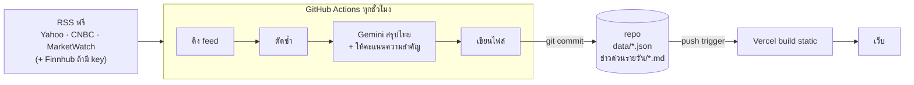

# Finanza — Design v0.2 (ไม่มี database)

> v0.2 แทนที่ v0.1 (Postgres + VPS) ตามโจทย์ใหม่: เว็บส่วนตัว ไม่มี DB ใช้แหล่งฟรี สรุปไทย และมีโฟลเดอร์ "ข่าวด่วนรายวัน"

## หลักคิด: ใช้ git เป็นที่เก็บข้อมูล

ข่าวรายชั่วโมงมีไม่กี่สิบชิ้น ข้อมูลทั้งเดือนแค่ไม่กี่ MB จึงเก็บเป็นไฟล์ JSON ใน repo ได้สบาย ได้ประวัติย้อนหลัง (git log) ฟรี และหน้าเว็บ build เป็น static จากไฟล์เหล่านี้



| ส่วน | เลือก | เหตุผล |
|---|---|---|
| ตัวตั้งเวลา | GitHub Actions cron | ฟรี ไม่ต้องมีเซิร์ฟเวอร์ ใช้ ~1 นาที/รอบ อยู่ในโควตา private repo |
| ที่เก็บข้อมูล | ไฟล์ JSON ใน repo | ไม่ต้องดูแล DB, commit ใหม่ = trigger deploy อัตโนมัติ |
| สรุปไทย | Gemini Flash-Lite (free tier) | ฟรี เร็ว ส่งทีละ 12 ข่าว/request; สลับเป็น Claude ได้ด้วย env |
| เว็บ | Next.js static บน Vercel | API key อยู่แค่ใน GitHub Secrets ไม่ถูกเปิดเผยบนเว็บ |

ทำไมไม่ให้ Vercel ดึงข่าวเองตอนมีคนเปิดเว็บ (ISR): การสรุปด้วย LLM ใช้เวลาหลายสิบวินาทีและอาจโดน rate limit ถ้าทำใน request ของผู้ใช้ เว็บจะช้าหรือพัง และต้องเก็บ key ไว้บน Vercel แยกงานหนักไปไว้ที่ Actions จึงเสถียรกว่า

## Pipeline (scripts/fetch-news.ts)

1. **ดึง** ทุก feed พร้อมกัน feed ที่ล่มจะถูกข้ามและบันทึกใน `data/meta.json`
2. **กรองอายุ** เอาเฉพาะข่าวไม่เกิน 36 ชม.
3. **ตัดซ้ำ 2 ชั้น**
   - URL เดียวกัน: ตัด tracking params (`utm_*`, `mod`, `.tsrc`) แล้ว hash เป็น id
   - เรื่องเดียวกันต่างสำนัก: ความคล้ายของคำในหัวข่าว (Jaccard) ≥ 0.6 ภายใน 24 ชม. → รวมเป็นชิ้นเดียว เก็บสำนักอื่นไว้ใน `alsoReportedBy`
4. **สรุปไทย** เฉพาะข่าว `pending` (ใหม่สุดก่อน ไม่เกิน 60 ชิ้น/รอบ) ให้ LLM คืน JSON: ตัดสินว่าเกี่ยวกับหุ้น US ไหม, หัวข่าวไทย, สรุป 2–3 ประโยค, ผลต่อหุ้น, ความสำคัญ 1–10, ทิศทาง, ticker (กรองให้เหลือเฉพาะใน S&P 500) — ถ้า LLM พังจะลองใหม่รอบถัดไป สูงสุด 3 ครั้ง
5. **เขียนไฟล์** เฉพาะวันที่เปลี่ยน แล้วคำนวณ **ข่าวด่วนรายวัน** ของวันนั้นใหม่
6. **ล้าง** `data/news` ที่เก่ากว่า 30 วัน (สรุปรายวันเก็บถาวร)

รันซ้ำกี่รอบก็ได้ผลเหมือนเดิม (idempotent) เพราะข่าวที่มี id แล้วจะถูกข้าม

## ข่าวด่วนรายวัน (Top 2)

- "วัน" นับตามเวลาไทย (Asia/Bangkok)
- คะแนน = `ความสำคัญ × 10 + จำนวนสำนักที่รายงานเพิ่ม (สูงสุด 3) × 3` → เรียงมากไปน้อย เอา 2 อันดับแรก
- อัปเดตทุกชั่วโมงตลอดวัน ไฟล์ของวันที่จบแล้วจะนิ่ง (เว้นข่าวที่ feed ส่งมาช้า)
- เขียน 2 ที่: `ข่าวด่วนรายวัน/YYYY-MM-DD.md` (คนอ่าน เปิดบน GitHub ได้) และ `data/daily/YYYY-MM-DD.json` (หน้าเว็บใช้)

## โครงสร้างไฟล์

```
config/sources.ts          รายการ RSS และค่าปรับแต่ง (เพิ่ม/ลบ feed ที่นี่)
lib/feeds.ts               ดึงและ parse RSS / Finnhub
lib/normalize.ts           canonical URL, ความคล้ายหัวข่าว
lib/llm.ts                 Gemini / Anthropic / mock ผ่าน fetch ตรง
lib/summarize.ts           prompt + ตรวจ JSON ด้วย zod
lib/daily.ts               จัดอันดับ Top 2 + สร้าง Markdown
lib/store.ts               อ่าน/เขียนไฟล์ JSON
scripts/fetch-news.ts      entrypoint ของ Actions
app/                       หน้าเว็บ: / (Top 2 + ฟีด), /daily, /daily/[date]
data/sp500.json            รายชื่อ S&P 500 (อัปเดตทุกวันจันทร์)
data/news/YYYY-MM-DD.json  ข่าวทั้งหมดของวัน (ใช้เป็น cache ด้วย)
data/daily/YYYY-MM-DD.json Top 2 ของวัน
ข่าวด่วนรายวัน/            Markdown Top 2 รายวัน
```

## ข้อจำกัดที่ยอมรับ

- อัปเดตจริงทุก ~1 ชม. บวกดีเลย์ของ GitHub cron (ปกติไม่กี่นาที บางช่วงอาจ 10–20 นาที)
- Yahoo RSS ไม่มีเนื้อย่อ LLM เห็นแค่หัวข่าว → สรุปจะสั้นกว่าข่าวจาก CNBC/MarketWatch
- ความสำคัญ 1–10 เป็นการประเมินของ LLM ไม่ใช่การวัดราคาจริง (ถ้าอยากวัดจริงภายหลัง เพิ่มราคา SPY/หุ้นได้จาก Finnhub `/quote`)
- Gemini free tier: Google อาจใช้ข้อมูลที่ส่งไปปรับปรุงโมเดล ซึ่งไม่มีปัญหาสำหรับข่าวสาธารณะ
